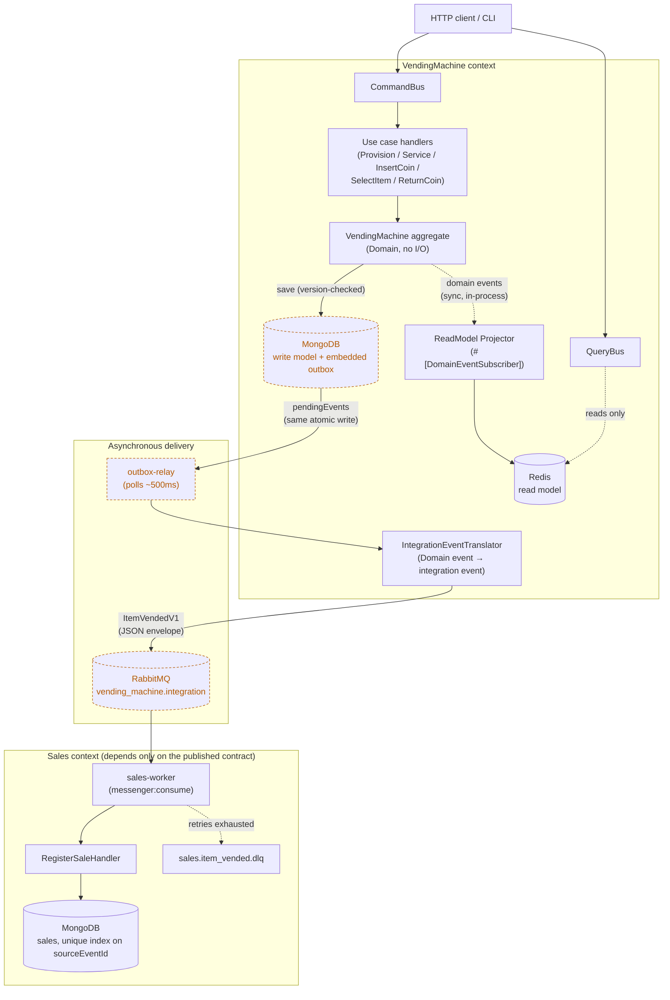

# Vending Machine

A vending machine, built on standalone Symfony components (no
`framework-bundle`), with a MongoDB-backed write model (Doctrine ODM), a
Redis-backed read model, and integration events published to RabbitMQ.

**Current state: the full customer journey, plus the first integration
event and its first consumer.** The whole stack boots end-to-end —
HTTP, CLI, MongoDB, Redis, RabbitMQ, dependency injection, a Messenger command
bus, and a
three-layer test suite — and carries the customer-facing use cases: provision a
vending machine (declaring the denominations it accepts), service it (declare its
true item stock, coin reserve and accepted denominations), read its current state
back, insert coins toward the price of an item, select a product to vend it and
hand back any change due, and return every inserted coin before buying. The write side lives in MongoDB (Doctrine ODM), the read side in
Redis, and the two are kept in step by domain events published synchronously
after each command. When an item is vended, a versioned
`vending_machine.item_vended.v1` message is reliably published to a
RabbitMQ topic exchange through an embedded outbox and a polling relay. A second
bounded context, **Sales**, consumes that message from its own queue and
registers a Sale, depending only on the published contract — never on the
vending machine's code. The published `item_vended.v1` contract is documented
spec-first with AsyncAPI 3.0 from both sides
(see [Integration contract](#integration-contract-asyncapi)) and kept honest
by contract tests, and a
health check still round-trips data through both stores.

## Requirements

* Docker & Docker Compose (everything runs in containers — no local
  PHP/MongoDB/Redis/RabbitMQ needed)
* To run things outside Docker instead: PHP ≥ 8.4 with the `mongodb` and
  `amqp` extensions, Composer, a reachable MongoDB 7, Redis 7 and RabbitMQ 3

## Running it

```bash
docker compose up -d --build
```

This starts six services: `app` (PHP, serving HTTP on `:8000`),
`mongodb`, `redis`, `rabbitmq` (AMQP on `:5672`, management UI on
[http://localhost:15672](http://localhost:15672), guest/guest),
`outbox-relay` (publishes pending outbox events as integration events; watch
it with `docker compose logs -f outbox-relay`) and `sales-worker` (the Sales
context's consumer; watch it with `docker compose logs -f sales-worker`).

Check that everything is wired up correctly, via HTTP:

```bash
curl http://localhost:8000/health
# -> {"mongo":true,"redis":true,"healthy":true}
```

...or via the CLI, which dispatches the exact same command through the same
bus:

```bash
docker compose exec app php bin/console app:health-check
# -> {"mongo":true,"redis":true,"healthy":true}
```

## Using it

Provision a machine, declaring the denominations it accepts from a customer
(empty stock, empty cash reserve, no inserted funds), and note its id:

```bash
curl -s -X POST http://localhost:8000/vending-machines \
  -H 'Content-Type: application/json' \
  -d '{"acceptedDenominationsInCents":[5,10,25,100]}'
# -> {"id":"01a12f94-62ac-771b-a72a-f8a35ea379bb"}
```

Service it: declare its **true** item stock and coin reserve, and the
denominations it is reconfigured to accept. These replace the previous state,
they are not added to it — and the action is rejected with a
`PendingTransactionInProgress` (HTTP 409) while a customer transaction is in
flight.

```bash
curl -s -X POST http://localhost:8000/vending-machines/$ID/service \
  -H 'Content-Type: application/json' \
  -d '{"stock":[{"selectorCode":"WATER","priceInCents":65,"stock":10}],
       "cashReserve":[{"denominationInCents":100,"quantity":5}],
       "acceptedDenominationsInCents":[5,10,25,100]}'
```

Read the current state back from the Redis read model:

```bash
curl -s http://localhost:8000/vending-machines/$ID
# -> {"id":"...","acceptedDenominationsInCents":[5,10,25,100],
#     "stock":[{"selectorCode":"WATER","priceInCents":65,"stock":10}],
#     "cashReserve":[{"denominationInCents":100,"quantity":5}],"insertedFundsInCents":0}
```

Insert a coin: the machine accepts the denominations it was provisioned with
(5, 10, 25 and 100 in this example), rejects anything else, and the response
carries the updated balance (`insertedFundsInCents`):

```bash
curl -s -X POST http://localhost:8000/vending-machines/$ID/coins \
  -H 'Content-Type: application/json' \
  -d '{"denominationInCents":25}'
# -> {"id":"...","stock":[...],"cashReserve":[...],"insertedFundsInCents":25}
```

Select a product: when the inserted funds cover its price, the machine vends it
and returns any change due, made from its cash reserve (never from the coins just
inserted), decrementing stock and reserve and resetting the balance:

```bash
curl -s -X POST http://localhost:8000/vending-machines/$ID/selections \
  -H 'Content-Type: application/json' \
  -d '{"selectorCode":"WATER"}'
# -> {"id":"...","selectorCode":"WATER","priceInCents":65,"change":[25,10],"insertedFundsInCents":0}
```

A selection the machine cannot serve is rejected with a clear reason (HTTP 409):
`InsufficientFunds` (the balance is kept so the customer can top up), `OutOfStock`
(the balance is kept), or `InsufficientChangeAvailable` (the whole balance is
returned).

Changed your mind before selecting? Return every inserted coin: the machine hands
back exactly the coins you put in — never a set drawn from its change reserve —
and resets the balance to zero. Returning with nothing inserted is a no-op:

```bash
curl -s -X POST http://localhost:8000/vending-machines/$ID/return-coin
# -> {"id":"...","returnedCoins":[10,10],"insertedFundsInCents":0}
```

The **Sales** context consumes the vended-item messages the relay publishes and
registers one Sale per message. List them (a demo read; the worker must have
consumed the message first, which happens within a moment):

```bash
curl -s http://localhost:8000/sales
# -> [{"saleId":"...","vendingMachineId":"...","selectorCode":"WATER",
#      "priceInCents":65,"soldAt":"2026-10-14T10:30:00+00:00","sourceEventId":"..."}]
```

The same use cases are available through the CLI, dispatching the exact same
commands through the same bus:

```bash
docker compose exec app php bin/console app:vending-machine:provision \
  --accepted-denominations-in-cents='[5,10,25,100]'
docker compose exec app php bin/console app:vending-machine:service $ID \
  --stock='[{"selectorCode":"WATER","priceInCents":65,"stock":10}]' \
  --cash-reserve='[{"denominationInCents":100,"quantity":5}]' \
  --accepted-denominations-in-cents='[5,10,25,100]'
docker compose exec app php bin/console app:vending-machine:insert-coin $ID --denomination-in-cents=25
docker compose exec app php bin/console app:vending-machine:select-item $ID WATER
docker compose exec app php bin/console app:vending-machine:return-coin $ID
docker compose exec app php bin/console app:vending-machine:show $ID
```

### Worked examples

A machine serviced with `WATER` (0.65), `JUICE` (1.00) and `SODA` (1.50), and a
change reserve of 40×0.25, 40×0.10 and 40×0.05, replays the specification's
examples:

```
1, 0.25, 0.25, select SODA   -> SODA
1, select WATER              -> WATER, 0.25, 0.10
0.25, select WATER           -> InsufficientFunds (balance kept)
0.10, 0.10, return-coin      -> 0.10, 0.10
```

## Running the tests

```bash
docker compose exec app vendor/bin/phpunit --testsuite=unit          # fast, no infra

docker compose exec -e MONGO_DB=vending_test -e REDIS_URL=redis://redis:6379/1 \
  app vendor/bin/phpunit --testsuite=integration

docker compose exec -e MONGO_DB=vending_test -e REDIS_URL=redis://redis:6379/1 \
  app vendor/bin/phpunit --testsuite=functional

# or simply, for everything:
docker compose exec -e MONGO_DB=vending_test -e REDIS_URL=redis://redis:6379/1 \
  app vendor/bin/phpunit
```

The integration suite drives its own outbox relay and Sales worker against the
real broker, so stop the long-running worker services first — they would
otherwise compete for the same queues:
`docker compose stop outbox-relay sales-worker`.

* **Unit** (`tests/Unit`) — domain value objects and entities
  (`Money`, `Denomination`, `AcceptedDenominations`, `Product`, `ChangeDue`,
  `InsertedFunds`, `VendingMachine`), exercised in isolation with no I/O,
  including the service
  replace semantics, the mid-transaction rejection, coin insertion (accepted
  denominations accumulating, rejected ones leaving the balance untouched),
  returning inserted funds (the exact coins handed back, the no-op case and the
  reserve staying untouched), change-making (largest denominations first,
  backtracking when a greedy choice cannot be completed) and all four selection
  outcomes. It also covers the domain events: the event each mutation records
  (and its payload) and the rejections that record nothing. The integration
  event translator and the JSON envelope serializer are covered here too:
  the exact published envelope, and which events are (not) translated — as is
  the AsyncAPI contract: the serialized message and the spec's own example are
  both validated against the payload schema from `docs/asyncapi`, and the
  Sales consumer contract test decodes the producer spec's own example into
  `ItemVendedV1Received`.
* **Integration** (`tests/Integration`) — the MongoDB repository, the Redis
  read-model repository and the
  provision/service/insert-coin/select-item/return-coin use cases dispatched
  through the real command bus against real instances, so the event publication
  and the projection run as in production — including the rules that a command
  rejected after mutating still publishes its events and a no-change command
  publishes nothing. The outbox is covered against real infrastructure: saves
  append `pendingEvents` atomically with the state change, and the relay is
  run against a real RabbitMQ (a test queue bound to the routing key) proving
  exactly one `item_vended.v1` message is published per sale, that other
  events are dropped from the outbox unpublished, and that a failed publish
  stays pending and is retried. The Sales consumer is covered end-to-end the
  same way: a vended item reaches `sales.item_vended`, the worker registers
  exactly one Sale, re-delivering the message registers no second Sale, and a
  message whose handling fails is dead-lettered to `sales.item_vended.dlq`
  once its retries are exhausted.
* **Functional** (`tests/Functional`) — boots the real HTTP application and the
  real CLI commands and exercises provisioning, servicing, inserting coins,
  reading state, selecting products and returning inserted coins (plus the
  mid-transaction, rejected-denomination and rejected-selection cases) through
  the full request/response (and input/output) cycle, Messenger bus included.
  The four specification examples are replayed end-to-end.

CI runs all three suites automatically on every push and pull request (see
`.github/workflows/tests.yml`).

## Code quality

Formatting, linting, static analysis and architectural guards are handled by
[Mago](https://mago.carthage.software/), configured in [`mago.toml`](./mago.toml).
The guard enforces the hexagonal layering (Domain ← Application ←
Infrastructure), keeps Symfony, Doctrine, MongoDB and Predis out of the inner
layers (the shared `Uuid` value object is the one deliberate exception, built
on the `symfony/uid` component), and pins naming and modifier conventions on
controllers, commands, repositories, domain models and domain exceptions.

Run the four checks through Composer (or `vendor/bin/mago <tool>` directly):

```bash
composer fmt:check   # mago format --check
composer lint        # mago lint
composer analyse     # mago analyze
composer guard       # mago guard

# or all four at once:
composer quality
```

`composer fmt` rewrites files, and `composer fix` runs the full
guard → analyze → lint → format loop until it converges.

Both workflows run on every push and pull request: `.github/workflows/tests.yml`
runs the three test suites, and `.github/workflows/quality.yml` runs the four
checks above.

### Optional pre-commit hook

A pre-commit hook that runs `mago format --staged`, `mago lint --staged` and
`mago analyze --staged` is committed under [`hooks/`](./hooks). Enable it once
per clone:

```bash
git config core.hooksPath hooks
```

It uses a local `vendor/bin/mago` when available and otherwise runs Mago inside
the app container; when neither is available it skips with a warning, since CI
enforces the checks regardless.

## Integration contract (AsyncAPI)

The context's published language — the `vending_machine.item_vended.v1`
message, its JSON envelope and its AMQP bindings — is documented spec-first in
[`docs/asyncapi/`](./docs/asyncapi):

* [`vending-machine.asyncapi.yaml`](./docs/asyncapi/vending-machine.asyncapi.yaml)
  — the producer document (AsyncAPI 3.0): the channel, the `send` operation,
  the message with its correlation id, and its payload schema and example.
* [`sales.asyncapi.yaml`](./docs/asyncapi/sales.asyncapi.yaml)
  — the Sales consumer document (AsyncAPI 3.0): a `receive` operation on the
  same `vending_machine.item_vended.v1` message, with the `sales.item_vended`
  queue the worker binds to it. It reuses the shared component schema rather
  than restating the payload.
* [`components/schemas/`](./docs/asyncapi/components/schemas) — the reusable
  schemas both documents pull in through `$ref`: the shared integration event
  `envelope`, the item-vended `data`, and the primitive `cents` and
  `selector-code` types.

The spec is the source of truth for the contract, and the code is kept honest
with contract tests. On the producer side (`ItemVendedV1ContractTest`): it
serialises an `ItemVendedV1` with the real `JsonEnvelopeSerializer` and
validates the result against the payload schema from the spec, and it validates
the spec's own example too. On the consumer side
(`ItemVendedV1ReceivedContractTest`): the producer spec's own example decodes
into the Sales context's `ItemVendedV1Received`. Renaming or removing a field
on either side — a PHP event, the serializer, or the spec — fails a test.

### Versioning policy

A version is a compatibility promise, not a release number. Within `v1`,
changes may only **add** fields: a consumer written against the current
document must keep working when a field appears. Any change that would break
one — removing or renaming a field, changing its type, or changing its meaning
— is a breaking change and means publishing a new `.v2` channel alongside
`v1`, never editing `v1` in place. Consumers depend on a version, never on
`latest`.

### Validating and rendering locally

Both run through the [`asyncapi/cli`](https://hub.docker.com/r/asyncapi/cli)
Docker image, so no local Node.js is needed:

```bash
# Validate every spec
for spec in docs/asyncapi/*.asyncapi.yaml; do
  docker run --rm --user=root -v "$PWD:/work" -w /work \
    asyncapi/cli:6.2.1 validate "$spec"
done

# Render every document to HTML (one subdirectory per spec)
for spec in docs/asyncapi/*.asyncapi.yaml; do
  name=$(basename "$spec" .asyncapi.yaml)
  docker run --rm --user=root -v "$PWD:/work" -w /work \
    asyncapi/cli:6.2.1 generate fromTemplate "$spec" \
      @asyncapi/html-template@3.5.6 \
      --output "/work/asyncapi-docs/$name" --force-write --no-interactive
done
# -> asyncapi-docs/vending-machine/index.html, asyncapi-docs/sales/index.html
```

CI (`.github/workflows/quality.yml`) validates every spec and uploads the
rendered HTML as the `asyncapi-docs` artifact; the app does not serve it.

## Domain language

The vocabulary this codebase speaks — stock, cash reserve, inserted funds,
pending transaction, service — is defined in [`CONTEXT.md`](./CONTEXT.md).
Prefer those terms in code, comments and commits.

## Architecture

The runtime picture — two bounded contexts, the write/read split inside
`VendingMachine`, and the outbox → relay → broker → consumer chain that
connects them to `Sales`:



Dashed, orange-outlined nodes (`Mongo`, `Relay`, `Rabbit`) mark the parts of
this picture with a known, deliberate limitation — polling instead of change
streams, at-least-once delivery, a queue with no consumer-side policy yet —
spelled out in [Trade-offs / things I'd revisit next](#trade-offs--things-id-revisit-next)
below. The diagram shows what runs; it does not show what is out of scope —
there is no retry/circuit-breaker layer in front of Mongo/Redis/RabbitMQ
beyond what's described above, no caching, no auth/authz, and no multi-tenancy:
this is a single-machine, single-tenant slice built to demonstrate the
patterns, not a production deployment.

The static layout behind those boxes:

```
src/
├── Kernel/                     # Hand-assembled bootstrap: DI container,
│   │                            # HTTP front controller, infra factories.
│   │                            # No business logic lives here.
│   ├── Bus/                     # MessengerCommandBus / MessengerQueryBus adapters
│   └── IntegrationEvent/        # Messenger AMQP integration bus, JSON envelope
│                                # serializer, AMQP transport + console wiring
├── Shared/                     # Cross-aggregate building blocks
│   ├── Domain/Event/           # DomainEvent + DomainEventBus contracts + EventId
│   ├── Domain/ValueObject/     # the shared Uuid base, a UUIDv7 built on
│   │                            # symfony/uid; the ids extend it
│   ├── Application/Bus/        # Handler/subscriber markers + CommandBus/QueryBus ports
│   ├── Application/IntegrationEvent/ # IntegrationEvent base, IntegrationEventBus
│   │                                # port, IntegrationEventSubscriber marker
│   └── Infrastructure/EventBus/ # Collector, Messenger domain event bus and the
│                                # command-bus middleware that publishes on commit
├── VendingMachine/
    ├── Domain/                 # Pure business logic. No framework, no I/O.
    │   ├── Model/               # Money, Denomination, Product, ChangeDue,
    │   │                        # VendedItem, VendingMachineId, VendingMachine
    │   ├── Event/               # Recorded domain events (base + 6 concrete)
    │   ├── Repository/          # VendingMachineRepository (port)
    │   └── Exception/
    ├── Application/            # Use cases: orchestrates the domain,
    │   │                        # talks only to ports.
    │   ├── HealthCheck/         # Stack smoke test (command + handler + result)
    │   ├── ProvisionVendingMachine/  # Create a machine, seed the projection
    │   ├── ServiceVendingMachine/    # Service action: replace stock + cash reserve
    │   ├── InsertCoin/               # Customer inserts a coin; balance grows
    │   ├── SelectItem/               # Customer selects a product; vend + change
    │   ├── ReturnCoin/               # Customer takes back the coins inserted
    │   ├── GetVendingMachineState/   # Read-side query over the Redis projection
    │   ├── IntegrationEvent/    # The published language: versioned integration
    │   │                        # events (ItemVendedV1) — never the domain model
    │   ├── IntegrationEventTranslator/ # Domain event → integration event; the
    │   │                        # only code allowed to see both
    │   └── ReadModel/           # Read-model port + MachineStateView + the
    │                            # projector that subscribes to domain events
    └── Infrastructure/         # Adapters: the only place that knows about
        │                        # Mongo/Redis/RabbitMQ/HTTP/console.
        ├── Persistence/Mongo/   # Doctrine ODM document + repository (+ outbox)
        ├── ReadModel/Redis/     # Redis-backed read model repository
        ├── Http/                # HealthCheck + provision/service/insert-coin/select/return/get controllers
        └── Console/             # HealthCheck + vending-machine commands + the
                                 # outbox relay
└── Sales/                      # The first consuming context: depends on the
    │                            # published language only, never on VendingMachine.
    ├── Domain/                 # Sale (immutable) + SaleId + SaleRepository port
    ├── Application/            # RegisterSale/ListSales use cases, the
    │   │                        # consumer-owned ItemVendedV1Received message,
    │   └── IntegrationEventSubscriber/ # and the subscriber mapping the message
    │                            # to RegisterSale
    └── Infrastructure/         # Adapters for Sales.
        ├── Persistence/Mongo/   # sale repository, unique index on sourceEventId
        └── Http/                # GET /sales (demo read)
```

This is a hexagonal/ports-and-adapters layout: `Domain` and `Application`
depend only on **interfaces** (`VendingMachineRepository`,
`VendingMachineStateReadModelRepository`); `Infrastructure` provides the
Mongo/Redis/HTTP/console implementations, wired together in
`config/services.yaml`. Swapping MongoDB or Redis for something else, or
adding a new driving adapter next to HTTP and the console, never touches the
domain.

### No framework bundle

There is no `symfony/framework-bundle` here — only standalone components.
`src/Kernel/ContainerFactory` builds a `Symfony\Component\DependencyInjection\ContainerBuilder`
from `config/services.yaml` and compiles it; `src/Kernel/HttpApplication`
wires `symfony/routing` + `symfony/http-kernel`'s `HttpKernel` directly
around that container; `bin/console` builds a plain `symfony/console`
`Application` from the same container. Both entry points therefore share
identical service wiring.

### CQRS-shaped from day one

Three Symfony Messenger buses (`config/services.yaml`) carry the messaging, each
with its own synchronous, in-memory handlers locator. `command.bus` handles the
write use cases — `ProvisionVendingMachine`, `ServiceVendingMachine`,
`InsertCoin`, `SelectItem`, `ReturnCoin` and the `HealthCheck` smoke test —
while `query.bus` handles the read-side `GetVendingMachineState` query, and
`domain_event.bus` carries the domain events a command recorded to its
subscribers.

Handlers self-register: a handler class marked `#[CommandHandler]` is
autoconfigured onto `command.bus`, one marked `#[QueryHandler]` onto
`query.bus`, and every public event method of a class marked
`#[DomainEventSubscriber]` onto `domain_event.bus` by
`App\Kernel\ContainerFactory`, so adding a use case or a reaction is adding the
class — no hand-written message→handler map. Symfony's own
`MessengerPass` builds each bus and its handlers locator from those tags, and a
compiler pass refuses to compile when a command or query ends up with zero
handlers or more than one — while an event may have any number of subscribers.

The driving adapters depend on framework-free ports, not on Messenger: the
read side (`GetVendingMachineController`, `GetVendingMachineCommand`) asks
through `QueryBus` (`ask(object $query): mixed`) and the write side (every
`*Controller` and `*Command`) handles through `CommandBus`
(`handle(object $command): mixed`). Only the `App\Kernel\Bus\Messenger*Bus`
adapters know the framework; the command adapter also unwraps Messenger's
`HandlerFailedException`, so the adapters catch domain exceptions directly.

### Domain events, published on commit

Every mutation on the `VendingMachine` aggregate records a domain event: a
readonly, timestamp-free fact carrying the aggregate identity and the full
resulting state, plus the action's own data (the coin inserted, the item
vended, the funds returned). Rejections that throw before mutating record
nothing, and an exact-change rejection records the refund — naming the
rejected selector code — before it throws.

Every event also carries the two pieces of identity infrastructure cannot
derive on its own:

- an **event id** (`App\Shared\Domain\Event\EventId`, a UUIDv7 minted through
  the shared `Uuid` base when the event is recorded), unique across every event
  ever recorded, so a store or bus can recognise the same fact when it sees it
  again; and
- the **aggregate version** the mutation left the machine at. The aggregate
  bumps its version exactly once per mutation that records an event, and the
  repository flushes exactly one recorded mutation per save, so the version
  stays in step with the optimistic-locking version ODM manages on the
  document — a stale save is rejected by the lock, not silently reordered.

Each event exposes a `fromPayload()` named constructor, the exact inverse of
its `payload()`, so a persisted event can be read back into a domain object
without knowing its shape.

Recording and publishing are deliberately separate: the aggregate only records,
and infrastructure publishes once the write has committed. Concretely
(`App\Shared\Infrastructure\EventBus\`):

1. `MongoVendingMachineRepository::save()` releases the aggregate's recorded
   events **after a successful `flush()`** and hands them to the
   `DomainEventCollector` — a fact that never persisted is never published.
2. `PublishDomainEventsMiddleware`, sitting outside `handle_message` on the
   command bus, publishes the collected events in a `finally` — so a command
   whose handler throws *after* committing (the exact-change refund) still
   publishes its events, and a command that changed nothing publishes nothing.
3. `MessengerDomainEventBus` (the `DomainEventBus` port) dispatches each event
   on `domain_event.bus` on its own: a subscriber that throws is logged and
   swallowed, never failing a command whose write is already durable.

Domain events stay in-process and synchronous — they never go over a broker;
crossing contexts is the job of integration events, a separate concern. Because
publication is synchronous, the read-model projection it drives is up to date
by the time the command returns, so reads stay strongly consistent.

### Integration events: the outbox and the relay

Integration events are the context's *published language* — the messages other
contexts may depend on. They are deliberately separate from domain events:
separate classes with small primitive payloads, versioned
(`vending_machine.item_vended.v1`), travelling on their own
asynchronous bus to the durable topic exchange `vending_machine.integration` on
RabbitMQ, routed by event type. A Mago guard rule keeps the integration event
classes free of any `App\VendingMachine\Domain` import.

Three pieces make a vended item reach the broker reliably (see
[docs/adr/0001](./docs/adr/0001-publish-integration-events-via-an-embedded-outbox.md)
for the why):

1. **Embedded outbox.** `MongoVendingMachineRepository::save()` appends the
   aggregate's released events to the document's own `pendingEvents` array
   *before* `flush()`, so the state change and its outbox entries are one
   atomic single-document write. `occurredAt` is stamped at write time; the
   collection carries a multikey index on `pendingEvents.eventId`.
2. **Translation.** `VendingMachineIntegrationEventTranslator` (Application)
   is the only code allowed to see both domain and integration events. It
   maps `ItemVended` to `ItemVendedV1` — envelope id and correlation id are
   the domain event's id — and drops every other event: the published
   language exposes only what other contexts may know.
3. **Polling relay.** `app:outbox:relay` (the `outbox-relay` compose service)
   polls the write-side documents about every 500 ms
   (`--poll-interval-ms`), replays each document's pending entries in
   aggregate-version order, rebuilds the domain event (`fromPayload`),
   translates it, publishes through the AMQP transport — persistent messages,
   waiting for the broker's publisher confirm — and only then `$pull`s the
   entry by its event id. A failed publish stays pending and is retried on
   the next poll, so delivery is **at-least-once**: consumers must
   deduplicate on the envelope `id`.

On the wire every message is a JSON envelope (`JsonEnvelopeSerializer`, a
Messenger `SerializerInterface` — never PHP's `serialize()`):

```json
{ "id": "uuid", "type": "vending_machine.item_vended.v1", "source": "vending-machine",
  "occurredAt": "RFC3339", "aggregateId": "...", "aggregateVersion": 7,
  "correlationId": "...", "data": { "vendingMachineId": "...", "selectorCode": "...",
  "priceInCents": 65, "changeInCents": [25, 10] } }
```

`messenger:consume` and `messenger:setup-transports` are wired into
`bin/console` by hand (no framework-bundle). The context's own queue
(`vending-machine.integration`) is bound to `vending_machine.#`, so published
messages are visible in the [RabbitMQ management
UI](http://localhost:15672) even with no consumer.

### The Sales context: the first consumer

**Sales** is the first context to consume the published language, and it
depends on nothing else: it imports the shared building blocks and its own
classes, never `App\VendingMachine` — a Mago guard rule enforces that. It
knows the vending machine only by the id in the message.

The flow, once an item is vended:

1. The **relay** publishes `vending_machine.item_vended.v1` to
   `vending_machine.integration`, as before.
2. The Sales worker consumes the durable queue **`sales.item_vended`**, bound
   to that exchange with the one routing key it cares about. The transport has
   its own `JsonEnvelopeSerializer` instance mapping the wire type to
   **`ItemVendedV1Received`** — Sales' own message class, not the producer's.
3. `RegisterSaleOnItemVended` (a `#[IntegrationEventSubscriber]`) maps the
   message to a `RegisterSale` command and dispatches it on the command bus.
4. `RegisterSaleHandler` stores a `Sale` through the `SaleRepository` port. The
   `sales` collection carries a **unique index on `sourceEventId`** (the
   envelope `id`), so re-delivering the same message — delivery is
   at-least-once — is a silent no-op, not a second sale.
5. A message whose handling keeps failing is **retried with an exponential
   backoff** (1s, 2s, 4s) and, once the retries are exhausted, **dead-lettered
   to `sales.item_vended.dlq`**.

The worker is the `sales-worker` compose service
(`messenger:consume sales_integration_events`). The retry and failure-transport
listeners the framework would normally register are wired by hand in
`MessengerCommandsFactory`, since there is no `framework-bundle`. `GET /sales`
lists what the context has registered, through the query bus — a demo read.

### MongoDB (write model) / Redis (read model)

`VendingMachineDocument` (Doctrine ODM) is intentionally a separate class
from the `VendingMachine` domain aggregate; `MongoVendingMachineRepository`
is the only place that translates between them, and carries a `version` field
for optimistic concurrency. The Redis read model
(`RedisVendingMachineStateReadModelRepository`) stores one JSON document per
machine and is reachable only through the `VendingMachineStateReadModelRepository`
port. No write handler pushes to it: the
`VendingMachineReadModelProjector` — a `#[DomainEventSubscriber]` with one
method per event — projects the state every event carries into a
`MachineStateView` (provisioning seeds it, servicing replaces it, returning
resets the balance, and a rejected selection refreshes it too, because an
exact-change refund resets the balance), and `GetVendingMachineState` serves
reads straight from it without touching the write side. Write handlers stay
get → domain call → save.

## Extending it

* **New use case** — add a command/handler pair under `Application/`, mark the
  handler `#[CommandHandler]` (or `#[QueryHandler]`) so it self-registers, and
  add a driving adapter (an HTTP route + controller, and/or a console command)
  that dispatches it through the bus.
* **New product, coin, or business rule** — products stay generic
  (`Product`/`Denomination` value objects); a machine is stocked by declaring
  concrete rows, never by hardcoding a catalogue. New rules belong on the
  `VendingMachine` aggregate and are rejected with a domain exception.
* **New channel** — add a new adapter under `Infrastructure/` that handles
  existing commands through the `CommandBus` port (or asks queries through the
  `QueryBus` port). The HTTP controller and console command are the template: no
  business logic, only translating input/output.
* **New published event** — add a `*V1` class under
  `Application/IntegrationEvent/` (small primitive payload, no domain types —
  the guard enforces it), extend the translator's `match`, and register the
  type in the envelope serializer's map (`config/services.yaml`). Document the
  message in [`docs/asyncapi/`](./docs/asyncapi) — a new channel and message
  reusing the shared `envelope` — so the contract stays spec-first. Anything
  not translated is dropped from the outbox unpublished, by design.
* **New consuming context** — the Sales context is the template: add a
  consumer-owned message class extending the shared `IntegrationEvent`, a
  `#[IntegrationEventSubscriber]` that maps it to a command, and a queue bound
  to `vending_machine.integration` with the routing keys it cares about (see
  `config/services.yaml`). Give the transport its own `JsonEnvelopeSerializer`
  instance mapping the wire type to the consumer's class, register it as the
  consume command's receiver, and run it with `messenger:consume <transport>`.

## Trade-offs / things I'd revisit next

* The DI container is rebuilt (and recompiled) on every request/command
  invocation rather than cached to disk — acceptable at this scale, but a
  production deployment would dump the compiled container once and reuse it.
* `$_ENV`-based configuration in the infrastructure factories is simple but
  bypasses Symfony's `%env()%` parameter resolution; fine for three
  variables, worth revisiting if configuration grows.
* The read-model port still speaks a raw state array; `MachineStateView` is the
  typed projection on top of it. Folding the DTO into the port signature is a
  natural next step once a second projection shape exists.
* Accepted denominations are per-machine state (`AcceptedDenominations`), set at
  provisioning and replaceable at service, and flow through the Mongo document
  and the read-model projection. The amounts are still named `...InCents`, which
  bakes in a 1/100 minor unit; a `Currency` concept and a global rename to minor
  units is the follow-up.
* Inserted funds are modelled as the collection of the individual coins
  inserted (`InsertedFunds`), so a return can hand back exactly those coins —
  never a set drawn from the reserve. The read model still projects only their
  total (`insertedFundsInCents`); exposing the literal coins on the query side
  is a natural next step if a channel needs it.
* Change is made from the cash reserve with a bounded backtracking search over
  the denominations the machine actually holds. There is no cap on which
  denomination can be given back, so a reserve holding 1-unit coins would return
  them as change; the specification's "1 coins are never recirculated" rule would
  be a small, explicit filter on the search if it were wanted.
* A rejected selection is persisted and projected like a successful one, so the
  projection always reflects the balance after the attempt. That costs a
  no-op write on `InsufficientFunds` and `OutOfStock`, where the machine's state
  does not actually change.
* Integration event delivery is at-least-once: a relay crash between the
  broker's confirm and the outbox removal (or a lost race with a concurrent
  save) republishes a message, so consumers must deduplicate on the envelope
  `id`. The `correlationId` is simply the causing domain event's id — a real
  correlation chain can replace it when cross-context tracing matters.
* The relay polls instead of using MongoDB change streams, because change
  streams require a replica set and this stack runs a standalone node. The
  poll is cheap (a multikey index covers it) and tunable, and the published
  contract would not change if it ever became a change stream.
* Published messages accumulate in `vending-machine.integration` until the
  consuming slice lands — visible in the management UI, harmless at this
  scale, and worth a queue policy (or actual consumers) before real traffic.
* Two Mago rules are tuned in `mago.toml`: `too-many-methods` is raised and
  skips tests (test classes grow one method per case), and
  `inline-variable-return` is off because its fixer strips the `@var` that
  narrows a `mixed` value decoded from JSON. Both are configuration, not
  baselines — there are no baseline files.
